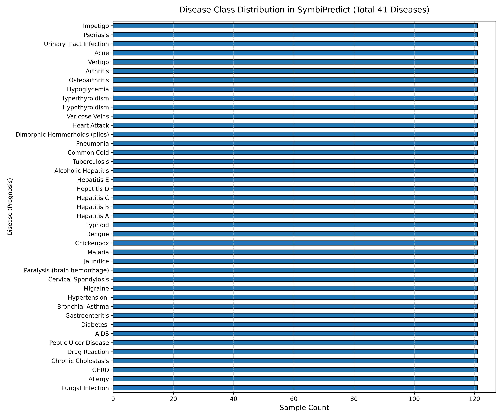
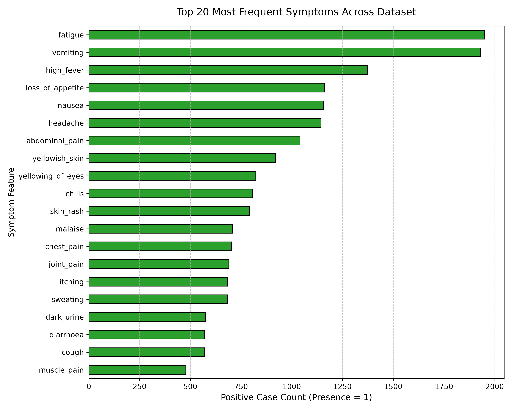
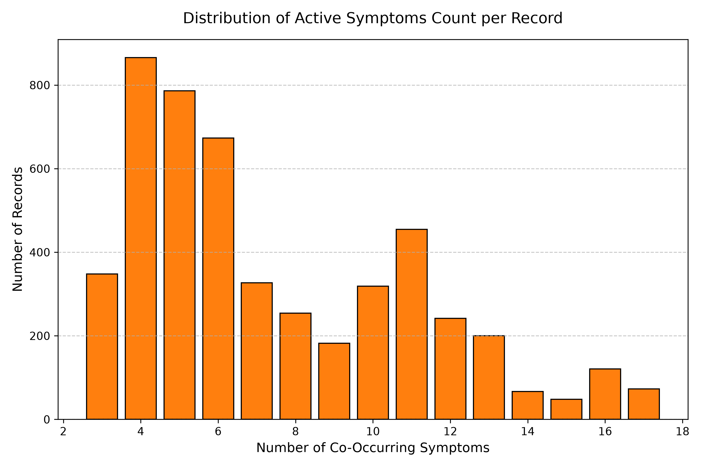
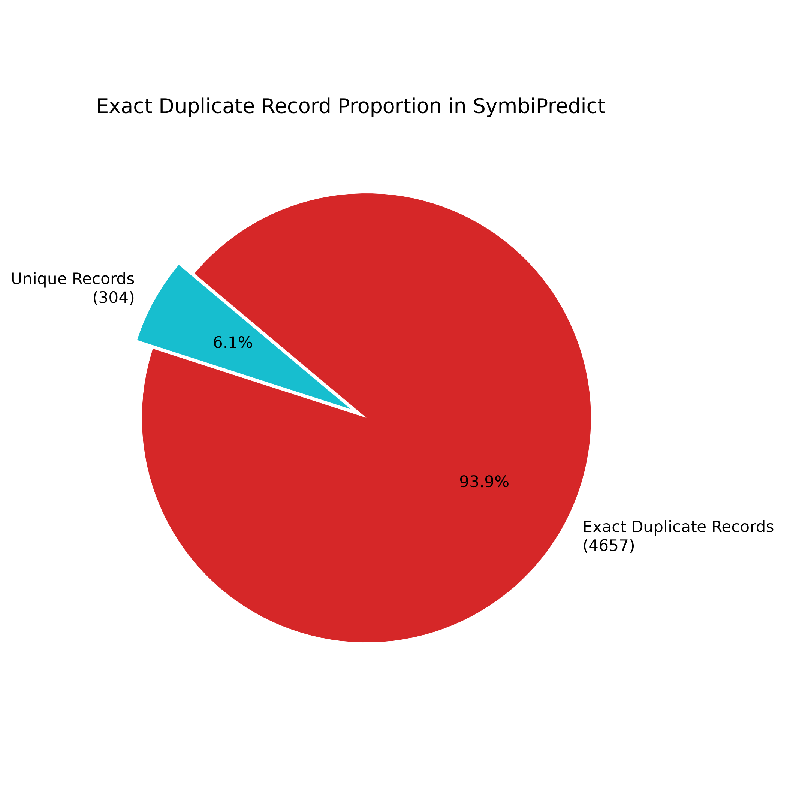

# Aarogya Drishti 2.0 — Phase 3, Task 3.1
## Symptom-Disease Dataset Acquisition and Quality Audit Report

**Date of Audit:** November 5, 2026  
**Audited Artifact:** `symbipredict_2022.csv`  
**Dataset Name:** SymbiPredict — Symptom-Disease Prediction Dataset (SDPD)  
**Publisher / Platform:** Mendeley Data  
**DOI:** `10.17632/dv5z3v2xyd.1`  
**Official Record:** [10.17632/dv5z3v2xyd.1](https://doi.org/10.17632/dv5z3v2xyd.1)  
**Reported License:** CC BY 4.0  
**Target Class Column:** `prognosis`  
**Audit Status:** Completed — **CONDITIONALLY_SUITABLE** for Research Prototyping  

---

## 1. Dataset Provenance & Integrity Verification

| Attribute | Specification | Verification Result |
| :--- | :--- | :--- |
| **Origin Repository** | Mendeley Data (Elsevier) | Official Repository Record Verified |
| **Dataset Title** | SymbiPredict (SDPD) | Matches Published Metadata |
| **Author / Contributor** | Jay Tucker (CDC Development Solutions) | Recorded in Manifest |
| **Publication Date** | 2024-04-02 | Verified via Public API |
| **Raw File Size** | 1,382,907 bytes (~1.32 MB) | Exact Byte Match |
| **SHA-256 Checksum** | `9834c90dd48eb2fef1fa56282f8f016a6781b0e4ada878015dc34a81af8e9e1b` | **Bit-for-Bit Verified Hash Match** |
| **Clinical Nature** | Research Benchmark / Synthetic Permutations | **Not Clinically Validated Real Patient Records** |

> [!IMPORTANT]
> SymbiPredict is a secondary research dataset generated through combinatorial symptom permutations based on clinical symptom lists. It must strictly be treated as an algorithmic exploratory benchmark, never as real-world patient epidemiological data.

---

## 2. Dataset Dimensions & Schema

* **Total Records (Rows):** 4,961
* **Total Columns:** 133
* **Symptom Features:** 132 features
* **Target Label:** 1 target feature (`prognosis`)
* **Feature Representation:** Binary Indicator (`binary_indicator_0_1` where `1` = symptom present, `0` = symptom absent).
* **Missing Values:** **0** (0.0% missing cells across all 133 columns).
* **Constant Columns (Zero Variance):** 1 features ['fluid_overload'].

---

## 3. Disease Target Distribution & Imbalance

* **Unique Diseases:** **41 classes** (comprising acute infections, non-communicable diseases, dermatological conditions, and metabolic syndromes).
* **Sample Count Range per Disease:** 121 to 121 samples (Mean: 121.0).
* **Class Imbalance Ratio:** **1.0** (Virtually balanced distribution across almost all 41 disease classes, indicative of synthetic template generation).
* **Rare Classes (<50% mean count):** None identified.

---

## 4. Symptom Characteristics & Burden

* **Active Symptoms per Patient:**
  * **Minimum:** 3 symptoms
  * **Maximum:** 17 symptoms
  * **Mean:** 7.45 symptoms
  * **Median:** 6.0 symptoms
  * **Zero-Symptom Records:** 0 records.
* **Top 5 Most Common Symptoms:**
  1. `fatigue`: 1949 cases
  2. `vomiting`: 1931 cases
  3. `high_fever`: 1374 cases
  4. `loss_of_appetite`: 1162 cases
  5. `nausea`: 1156 cases

---

## 5. Critical Data Quality, Duplication & Leakage Audit

### A. Severe Record Duplication
The audit revealed an extraordinary level of record duplication:
* **Exact Duplicate Rows:** **4,657 rows (93.87%)**.
* **Truly Unique Feature-Target Rows:** Only **304 rows (6.13%)** out of 4,961.
* **Unique Symptom Vector Patterns:** Only **304 distinct symptom combinations** generate the entire 4,961-row dataset.
* **Maximum Replication of a Single Pattern:** A single symptom combination is duplicated up to **91 times**.

### B. Conflicting Label Analysis
* **Conflicting Symptom Patterns:** **0**
* All identical symptom patterns map deterministically to the **same disease label**. There are zero conflicting labels across duplicate rows.

### C. Critical Data Leakage Warning for Model Splitting

> [!CAUTION]
> **HIGH RISK OF LEAKAGE UNDER NAIVE RANDOM SPLITTING:**
> Because **93.87%** of records are exact duplicates, executing a standard `train_test_split(test_size=0.2, random_state=42)` without deduplication will place identical symptom vectors and identical disease labels in both the training set and the test set.
> 
> A classifier evaluated on such a test set will simply memorize the duplicated training examples, yielding artificially inflated metrics (~99–100% accuracy) that represent pure data leakage rather than generalizable clinical learning.

---

## 6. Dataset Limitations

1. **Non-Clinical Synthetic Origins:** Feature combinations follow fixed deterministic templates rather than natural noisy epidemiological presentations.
2. **Absence of Negative / Absent Symptom Nuance:** Symptoms are binary (1/0), ignoring symptom duration, severity, onset chronology, and vital signs.
3. **Severe Multiplicity:** 4,961 records condense to only 304 unique samples.
4. **No Real Comorbidities:** Every sample exhibits exactly one disease label; dual diagnoses or secondary complications are completely absent.

---

## 7. Final Recommendation & Next Steps

### Recommendation: **CONDITIONALLY SUITABLE**
The dataset is approved for **exploratory proof-of-concept classifier development** under strict methodological controls:

1. **Mandatory Deduplication / Group Splitting:** Model training and evaluation pipelines must partition by *unique symptom pattern* or deduplicate before splitting to guarantee zero leakage between training and holdout test sets.
2. **Honest Baseline Reporting:** Both raw (replicated) and deduplicated evaluation scores must be reported side-by-side to expose the effect of synthetic duplication.
3. **Clinical Guardrail Enforcement:** Any model trained on this dataset must be clearly labeled as an unvalidated research prototype, with mandatory escalation for acute emergency red flags (integrating the Phase 2 `MedicalSafetyEngine`).
